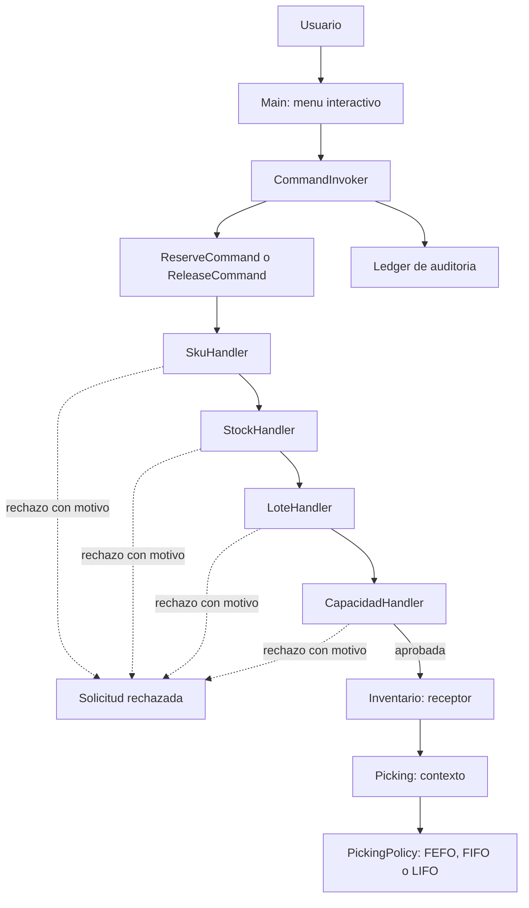
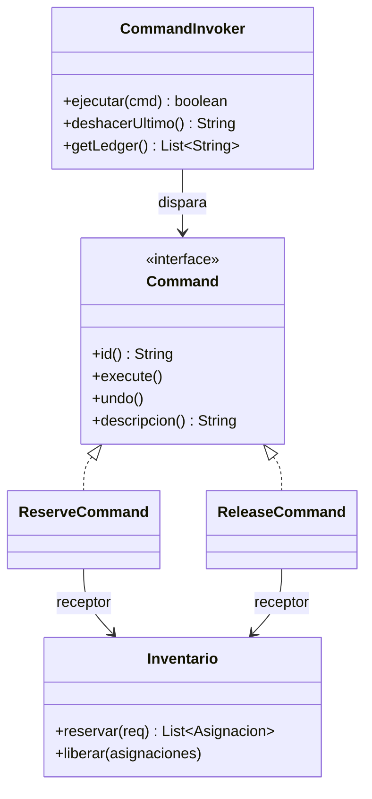
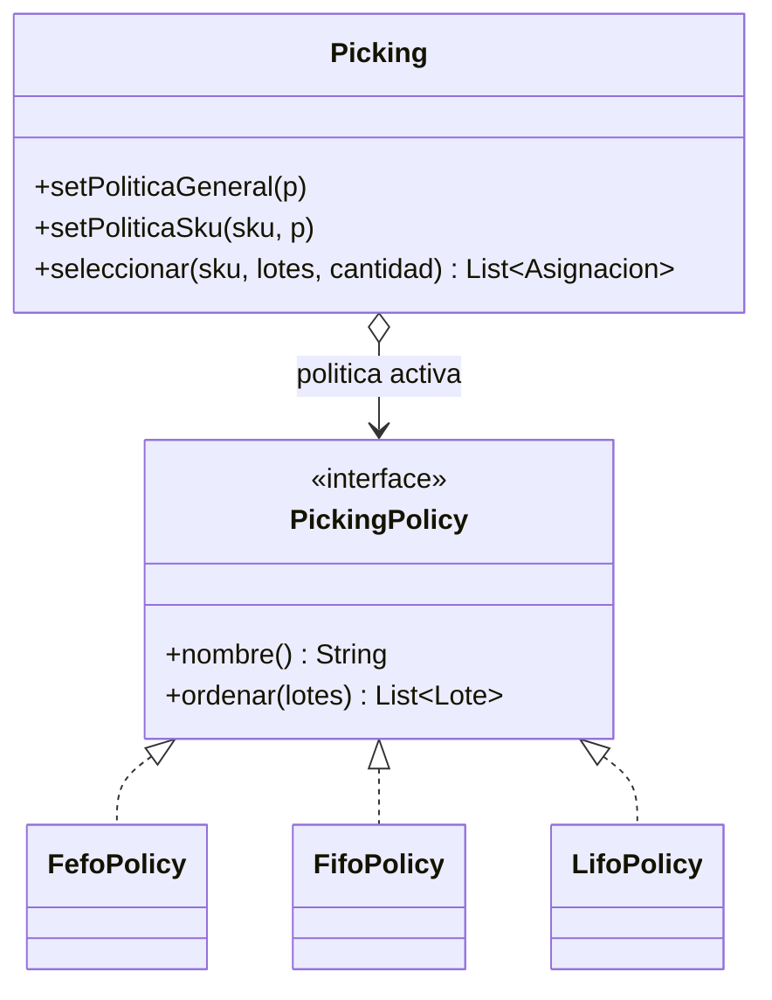
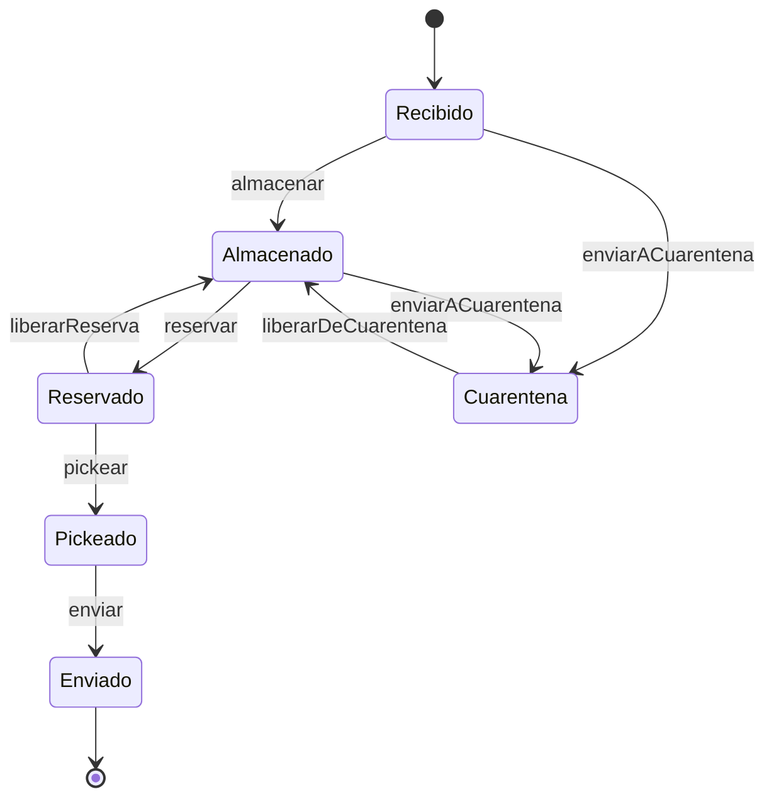
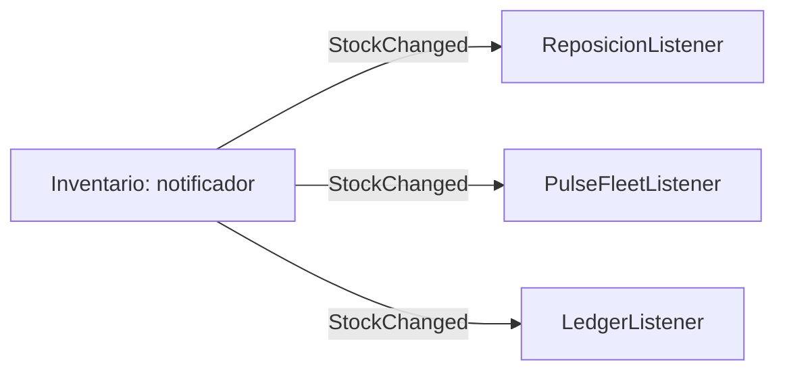

# LOGISTPULSE · Smart Inventory — Patrones de comportamiento (Java)

**Versión 1.0 · Proyecto académico por consola.** Implementación en Java de cinco patrones de comportamiento aplicados al Smart Inventory de LOGISTPULSE, siguiendo las diapositivas del curso (Universidad San Francisco de Quito, Colegio de Ciencias e Ingenierías).

Cada patrón vive en su propia carpeta y se compila y ejecuta por separado. Todos usan el mismo caso: una **reserva de stock** en una bodega. Los datos son ficticios y viven en memoria mientras el programa corre.

**Autora:** Alison Estrella

## Funcionalidades

- **Command** (`command/`): `ReserveCommand`, `ReleaseCommand` y `AdjustCommand` encapsulan cada operación con `execute()` y `undo()`. `CommandInvoker` solo dispara comandos y guarda el historial (deshacer), un ledger de auditoría y los ids ya procesados (idempotencia: reintentar con el mismo id no repite la operación).
- **Chain of Responsibility** (`chain/`): una reserva recorre `SkuHandler → StockHandler → LoteHandler → CapacidadHandler`. Cualquier eslabón puede detenerla y rechaza con un motivo claro (SKU inexistente, stock insuficiente, lote vencido o en cuarentena, capacidad excedida).
- **Strategy** (`strategy/`): `PickingPolicy` (FEFO, FIFO, LIFO) decide qué lotes se consumen primero y `ReplenishmentPolicy` (punto de reorden, Min-Max, EOQ) decide cuánto reponer. El contexto `Picking` cambia de política en tiempo de ejecución.
- **State** (`state/`): el lote pasa por Recibido → Almacenado → Reservado → Pickeado → Enviado, con Cuarentena como desvío. Cada estado es una clase y una transición inválida lanza `TransicionInvalidaException`.
- **Observer** (`observer/`): `Inventario` publica `StockChanged` y lo reciben `ReposicionListener`, `PulseFleetListener` y `LedgerListener`. Los suscriptores se agregan o se dan de baja en ejecución sin que el inventario los conozca.
- **Integrado con menú interactivo** (`integrado/`): sistema por consola donde se puede consultar productos y lotes, reservar stock (lote `AUTO` o un ID concreto), liberar reservas por UUID, deshacer, ver el ledger y cambiar las políticas de picking y de reposición en ejecución. Cada reserva pasa por la cadena de validación (Chain), es un comando auditable (Command) y elige lotes con la política activa (Strategy).

## Estructura del repositorio

```
command/     Command, Inventory (receiver), Reserve/Release/AdjustCommand, CommandInvoker, Demo
chain/       Manejador, SkuHandler, StockHandler, LoteHandler, CapacidadHandler, Bodega, Demo
strategy/    PickingPolicy, Fefo/Fifo/LifoPolicy, Picking (contexto), ReplenishmentPolicy, Demo
state/       EstadoLote, EstadoBase, Recibido ... Enviado, Cuarentena, Lote (contexto), Demo
observer/    StockListener, Inventario (notificador), 3 suscriptores, StockChanged, Demo
integrado/   Command + Chain + Strategy juntos con menu interactivo (src/logistpulse/: Main, Demo, Datos, model/, chain/, command/, strategy/)
```

## Correr el proyecto en GitHub Codespaces

1. Entra al repositorio en GitHub y pulsa **Code → Codespaces → Create codespace on main**.
2. Espera a que cargue el editor. Codespaces ya trae Java; no hace falta instalar nada.
3. Abre la terminal y ejecuta un patrón (cambia `command` por `chain`, `strategy`, `state` u `observer`):

```bash
mkdir -p out
javac -encoding UTF-8 -d out command/*.java
java -cp out command.Demo
```

Para ejecutar los cinco patrones seguidos:

```bash
for p in command chain strategy state observer; do
  mkdir -p out/$p
  javac -encoding UTF-8 -d out/$p $p/*.java && java -cp out/$p $p.Demo
done
```

Para el sistema interactivo (`integrado`):

```bash
mkdir -p out
javac -encoding UTF-8 -d out $(find integrado/src -name "*.java")
java -cp out logistpulse.Main      # menu interactivo
java -cp out logistpulse.Demo      # recorrido automatico, sin menu
```

Requiere JDK 17 o superior.

## Menú del sistema (`integrado`)

Al ejecutar `logistpulse.Main` aparece este menú:

| Opción | Acción |
|---|---|
| 1 | Consultar productos y lotes (incluye fecha de recepción, de vencimiento y estado: OK, VENCIDO o CUARENTENA) |
| 2 | Reservar stock: SKU, lote (`AUTO` o ID, por ejemplo `L-102`), cantidad y solicitante |
| 3 | Liberar una reserva por UUID (solo la puede liberar su solicitante) |
| 4 | Consultar reservas y los lotes asignados |
| 5 | Deshacer la última operación (`undo`) |
| 6 | Reintentar el último comando (muestra la idempotencia: un comando ya procesado no se repite) |
| 7 | Ver el ledger de auditoría |
| 8 | Cambiar la política de picking: FEFO, FIFO o LIFO, general o por SKU |
| 9 | Recomendación de reposición: punto de reorden, Min-Max o EOQ, general o por SKU (son sugerencias, no compras reales) |
| 10 | Poner o sacar un lote de cuarentena |
| 0 | Salir |

Reglas del sistema:
- En modo `AUTO`, la política de picking activa elige el lote (Strategy) y una reserva grande se reparte entre varios lotes.
- Con un ID de lote explícito, como `L-103`, se hace una reserva manual sobre ese lote.
- Nunca se usan lotes vencidos ni en cuarentena: la cadena SKU → stock → lote → capacidad los rechaza con un motivo.
- Los datos son ficticios y viven en memoria mientras el programa está abierto.

## Qué se ve al ejecutar cada demo

**Command:** una reserva repetida con el mismo id se marca como duplicada y no se ejecuta; una reserva imposible se rechaza; `undo` revierte en orden inverso.

```
OK        | C-1 | RESERVE SKU-LECHE x30
DUPLICADO | C-1 | RESERVE SKU-LECHE x30
RECHAZO   | C-3 | RESERVE SKU-LECHE x500 | Stock insuficiente de SKU-LECHE: hay 65, se pidieron 500
UNDO      | C-4 | RELEASE SKU-LECHE x10
```

**Chain:** cada rechazo indica qué eslabón falló.

```
RECHAZADA Solicitud[sku=SKU-XXX, cantidad=5] por SkuHandler: SKU inexistente: SKU-XXX
RECHAZADA Solicitud[sku=SKU-LECHE, cantidad=80] por LoteHandler: Lotes vencidos o en cuarentena: solo 60 u. utilizables
```

**Strategy:** la misma petición de 40 unidades toma lotes distintos según la política.

```
FEFO -> [L-B x30, L-A x10]
FIFO -> [L-A x30, L-B x10]
LIFO -> [L-C x30, L-B x10]
```

**State:** se muestran las transiciones y se rechazan las inválidas.

```
[L-001] RECIBIDO -> ALMACENADO
RECHAZADO al reservar un lote RECIBIDO: No se puede reservar un lote en estado RECIBIDO
```

**Observer:** un cambio de stock avisa a todos los suscriptores; al darse de baja, PULSEFLEET deja de recibir eventos.

```
[Reposicion] SKU-LECHE en 15 <= 20: se recomienda reponer
[PULSEFLEET] disponibilidad de SKU-LECHE actualizada a 15
```

## Arquitectura y diagramas

### Flujo del sistema integrado (`integrado/`)



### Command



### Strategy



La misma familia se repite en reposición: `ReplenishmentPolicy` con `ReorderPointPolicy`, `MinMaxPolicy` y `EoqPolicy`, usada por el contexto `Reposicion`.

### State



### Observer



### Ejemplo: FEFO, FIFO y LIFO

Tres lotes de `SKU-LECHE` con 30 unidades cada uno, y una reserva de 40 unidades (demo de `strategy/`):

| Lote | Ingreso | Vence |
|---|---|---|
| L-A | hace 10 días | en 40 días |
| L-B | hace 5 días | en 15 días |
| L-C | hace 1 día | en 90 días |

| Política | Criterio | Lotes asignados |
|---|---|---|
| FEFO | vence primero | L-B x30, L-A x10 |
| FIFO | entró primero | L-A x30, L-B x10 |
| LIFO | entró al final | L-C x30, L-B x10 |

## Relación con las diapositivas

| Patrón | Diapositiva | En LOGISTPULSE |
|---|---|---|
| Command | 2 | Reserve, Release y Adjust son comandos que se guardan en el ledger y se compensan con su inverso |
| Chain of Responsibility | 3 | SKU → stock → lote → capacidad; el eslabón que falla rechaza con un motivo |
| Strategy | 4 | PickingPolicy y ReplenishmentPolicy se eligen por producto o categoría |
| State | 5 | El lote es un autómata finito con Cuarentena como desvío |
| Observer | 6 | El inventario publica `StockChanged` sin conocer a sus suscriptores |

## Limitaciones

- Es un prototipo en memoria: no hay base de datos, concurrencia ni transacciones.
- En `command/`, el stock es un número por SKU; el reparto entre lotes se muestra en `strategy/` e `integrado/`.
- El ledger crece sin límite mientras el programa está abierto.
- No incluye pruebas automatizadas.
- Las recomendaciones de reposición usan parámetros fijos de ejemplo (por ejemplo, punto de reorden 20 y EOQ con costo de pedido 50 y de mantener 2).
